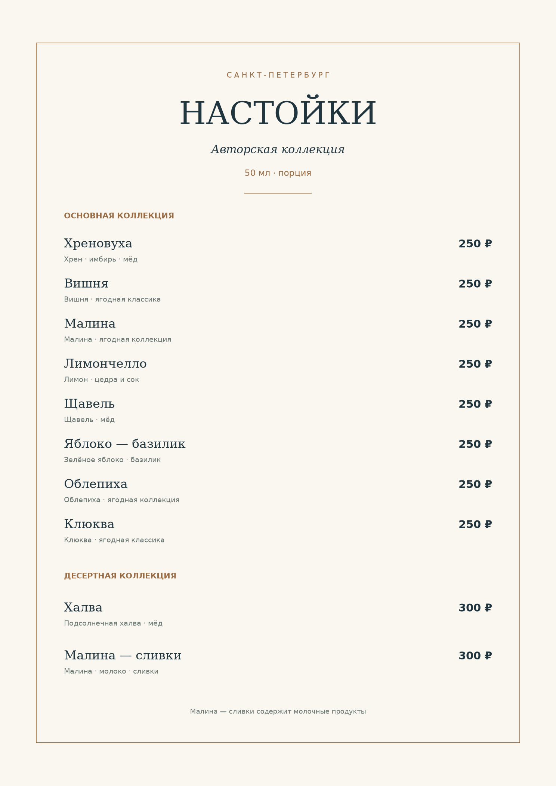

# Авторское меню настоек

**[Открыть исследование в Notebook](bar_menu_analysis.ipynb)** · **[Посмотреть меню PDF](results/nastoyka_menu.pdf)** · **[Скачать таблицу закупок](data/menu_raw_material_costs.csv)**

Какие настойки включить в барное меню и сколько сырья потребуется на два вечера? В проекте исследованы отзывы о барах Санкт-Петербурга и ассортимент конкурентов. Результат — десять выбранных автором напитков, готовое меню и расчёт сырьевых затрат.

## Данные и метод

В [исходной книге](data/nastoyki_reviews.xlsx) — 368 публикаций, из них 358 проверены. Для анализа конкретных вкусов подтверждены 198 упоминаний из 108 отзывов; [сводка](data/flavor_summary.csv) содержит 114 проверенных названий.

Хреновуха и щавель встречаются по 7 раз, по 5 упоминаний положительные. Эти небольшие базы помогли изучить ассортимент, но не доказывают спрос. Окончательные десять вкусов и разделение на восемь основных и два премиальных — решение автора. Отзывы не равны продажам. [Методика и ограничения](docs/methodology.md).

## Основные результаты

| Показатель планового сценария | Значение |
|---|---:|
| Авторское меню | 10 настоек |
| Производство | 60 л — по 6 л каждого вкуса |
| Порции | 1 200 по 50 мл |
| Первоначальная закупка | **40 002,80 ₽** |
| Использованное сырьё | **36 357,61 ₽** |
| Потенциальная выручка при полной продаже | **312 000 ₽** |

Основные напитки стоят 250 ₽, премиальные — 300 ₽ за 50 мл. Закупка включает целые упаковки; неиспользованное сырьё остаётся в запасе. Это сценарные результаты при оценочных выходах, а не фактические продажи или чистая прибыль.

## Вывод

Получилось меню, с которым можно обсуждать ассортимент и готовить общую закупку на два вечера. Равный выпуск десяти вкусов не гарантирует равного спроса. Цены и наличие сырья нужно подтвердить перед заказом.

## Структура проекта

- `bar_menu_analysis.ipynb` — исследование, выбор меню, расходы и выводы.
- `results/` — PDF-меню для гостей, превью и график себестоимости.
- `data/` — отзывы, сводка вкусов, общая закупка и итоговая экономика.
- `docs/methodology.md` — правила анализа и границы публичного воспроизведения.
- `scripts/portfolio.py` — сборка PDF/PNG; `tests/` — проверки публичных данных и материалов.

Публичный Notebook работает с готовыми экономическими выгрузками. Полный расчёт себестоимости по рецептурам в этой версии не воспроизводится: рецептуры и технологии исключены из текущего дерева файлов.
