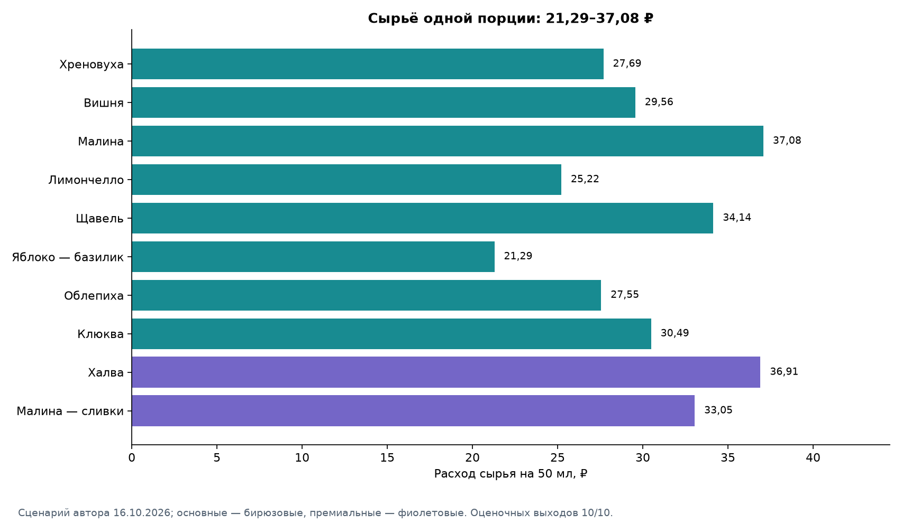

# Nastoyka · авторское меню настоек

**Личный проект: от исследования отзывов о петербургских барах до меню из десяти настоек с рассчитанными закупками и сырьевой себестоимостью.**

**[Посмотреть готовое меню](nastoyka_menu.ipynb)** · **[Таблица закупок](data/economics/menu_raw_material_costs.csv)** · [Исходная база отзывов](data/nastoyki_reviews.xlsx) · [Методика исследования](docs/methodology.md)

## Что получилось

| Итог | Значение |
| --- | ---: |
| Авторское меню | **10 вкусов**: 8 основных и 2 премиальных |
| Порция | **50 мл** |
| План производства | **60 л** — по 6 л каждого вкуса |
| Порций на два вечера | **1 200** |
| Закупка всех ингредиентов | **40 002,80 ₽** |
| Стоимость израсходованного сырья | **36 357,61 ₽** |
| Остаток сырья после производства | **3 645,19 ₽** |
| Потенциальная выручка при полной продаже | **312 000 ₽** |
| Разница выручки и расхода сырья | **275 642,39 ₽** |

Это **плановый сценарий**, не фактические продажи и не расчёт чистой прибыли. Цель проекта — подобрать ассортимент и определить закупочные расходы, без моделирования аренды, зарплат и прочих затрат бара.

## Итоговое меню

Восемь основных настоек продаются по **250 ₽**, две десертные премиальные — по **300 ₽** за 50 мл. Названия и цены выбраны автором; здесь приведены только стоимость порции и сырьевой расход, **без полных рецептур и дозировок**.

| Настойка | Цена за 50 мл | Сырьё на 50 мл |
| --- | --- | --- |
| Хреновуха | 250 ₽ | 27,69 ₽ |
| Вишня | 250 ₽ | 29,56 ₽ |
| Малина | 250 ₽ | 37,08 ₽ |
| Лимончелло | 250 ₽ | 25,22 ₽ |
| Щавель | 250 ₽ | 34,14 ₽ |
| Яблоко — базилик | 250 ₽ | 21,29 ₽ |
| Облепиха | 250 ₽ | 27,55 ₽ |
| Клюква | 250 ₽ | 30,49 ₽ |
| Халва | 300 ₽ | 36,91 ₽ |
| Малина — сливки | 300 ₽ | 33,05 ₽ |

[Открыть презентационное меню с карточками напитков и графиками →](nastoyka_menu.ipynb)

## Как выбирали вкусы

В исследовании собраны **368 публикаций**, из них **358 проверены**. Из отзывов выделены **198 подтверждённых конкретных упоминаний вкусов из 108 отзывов**; названия нормализованы до **114 вариантов**. Изучались предложения и впечатления гостей в барах и рюмочных Санкт-Петербурга.

Хреновуха и щавель получили по 5 положительных упоминаний из 7 конкретных. Данные помогли изучить ассортимент и составить варианты меню, но **отзывы не равны статистике продаж** и не доказывают оптимальность десяти выбранных вкусов. Окончательное меню — авторское решение.

[Исходный Excel](data/nastoyki_reviews.xlsx) · [Сводка](data/processed/summary.json) · [Справочник вкусов](data/processed/flavor_summary.csv) · [Сбор данных](docs/collection_report.md)

## Закупки и себестоимость

Поставщики: **Ладога** (водка), **METRO** (ягоды и большая часть остальных продуктов), **Агропарк СПб** (хрен, имбирь и зелёные яблоки). Одинаковое сырьё суммируется по всем напиткам, затем закупка округляется до целых упаковок.

| Поставщик | Плановая закупка |
| --- | --- |
| Ладога | 18 240,00 ₽ |
| METRO | 19 781,80 ₽ |
| Агропарк СПб | 1 981,00 ₽ |

**[Скачать / открыть агрегированную таблицу закупок](data/economics/menu_raw_material_costs.csv)** — 16 видов сырья, общая потребность, упаковки, цены, расходы и остатки. В ней нет распределения ингредиентов по отдельным рецептам.

Наценка и рассчитанная сырьевая маржинальность зависят от **оценочных**, а не измеренных выходов настоек. Стоимость закупки и стоимость израсходованных ингредиентов — разные показатели; остатки не списываются автоматически.

## Файлы проекта

| Материал | Для чего |
| --- | --- |
| **[Финальный Notebook](nastoyka_menu.ipynb)** | Презентация меню, итоги исследования, экономика и графики |
| **[Таблица сырья](data/economics/menu_raw_material_costs.csv)** | Готовая общая закупочная ведомость без рецептов |
| [Технический Notebook](assortment_economics.ipynb) | Подробные расчёты и технологии, для автора проекта |
| [Экономический отчёт](docs/economics_report.md) | Допущения, анализ и ограничения |
| [Исходное исследование](data/nastoyki_reviews.xlsx) | Отзывы и конкурентный ассортимент |

## Воспроизводимость

Результаты считаются из CSV/JSON, а таблица закупок создаётся автоматически. На Python 3.12:

    python -m pip install -r requirements.txt
    python scripts/economics.py
    python -m pytest -q
    python scripts/verify.py

GitHub Actions проверяет тесты, исходные данные и выполнение обоих Notebook в чистом окружении. [Проверка CI](.github/workflows/ci.yml) · [Протокол](docs/validation.md).

**Ограничения:** рецептуры выбраны автором, выходы ещё не измерены; цены и наличие необходимо подтверждать перед закупкой. Для молочной настойки срок безопасного коммерческого хранения не установлен. По содержанию задача составления меню и расчёта сырьевой экономики завершена.
