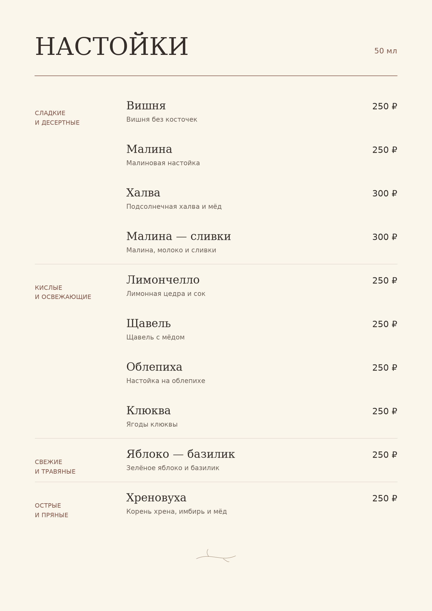

# Барное меню настоек

Разработка меню из 10 настоек на основе анализа отзывов гостей и ассортимента баров Санкт-Петербурга. Для выбранных напитков рассчитаны закупки, сырьевая себестоимость и потенциальная выручка за два вечера работы бара.

**[Анализ в Jupyter Notebook](https://github.com/Alina-lab/Bar_menu/blob/main/bar_menu_analysis.ipynb)** · **[Готовое меню](https://github.com/Alina-lab/Bar_menu/blob/main/technical/results/nastoyka_menu.pdf)** · **[Таблица закупок](https://github.com/Alina-lab/Bar_menu/blob/main/technical/data/menu_raw_material_costs.csv)**

## Исследование

Собраны 368 публикаций о барах и настойках, из которых 358 прошли проверку. В 108 отзывах найдено 198 конкретных упоминаний вкусов. Анализ помог изучить популярные сочетания и отзывы гостей, после чего был сформирован авторский ассортимент из 10 напитков.

Отзывы использовались как ориентир при выборе вкусов.

## Результаты

Составлено готовое меню с ценами 250 и 300 руб. за 50 мл. Для каждого напитка рассчитана сырьевая себестоимость, а для всего ассортимента подготовлена общая смета. Расчёты основаны на плановом сценарии при полной продаже напитков. Потенциальная выручка не является фактической, а затраты на сырьё не включают остальные расходы бара.

## Материалы проекта

- [Jupyter Notebook](bar_menu_analysis.ipynb) — исследование отзывов, расчёты.
- [Барное меню](technical/results/nastoyka_menu.pdf) — PDF с напитками и ценами.
- [Исходные данные](technical/data/nastoyki_reviews.xlsx) — отзывы.
- [Таблица закупок](technical/data/menu_raw_material_costs.csv) — расходы.
- [Экономика напитков](technical/data/menu_economics.csv) — стоимость сырья каждой настойки.
