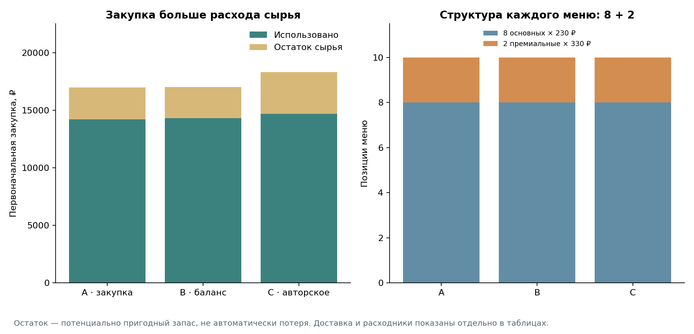
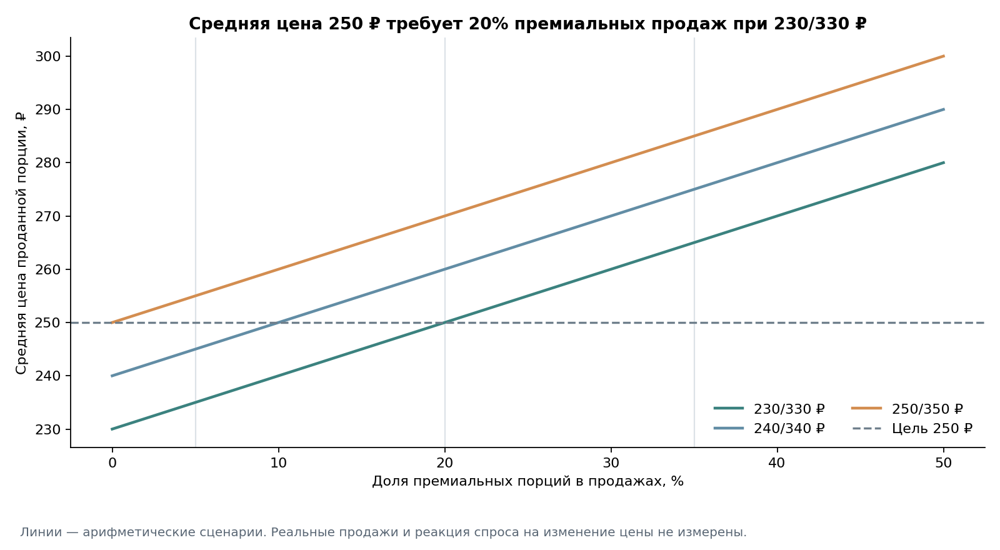

# Nastoyka: ассортимент из 10 настоек и экономика общей закупки

**[Исследование в Jupyter Notebook](assortment_economics.ipynb)** · **[Отчёт для проверки](docs/economics_report.md)** · [Постоянный план проекта](docs/project_plan.md)

Как собрать разнообразное меню бара Санкт-Петербурга и достичь средней цены проданной порции **250 ₽ за 50 мл**, учитывая отзывы, себестоимость и остатки целых упаковок?

**Предварительно выбрать B для пробных партий и проверки поставщиков.** Корзина A дешевле лишь на 16 ₽, а авторский вариант C требует на 1 302 ₽ больше B. Финальное меню пока не утверждено: выходы не измерены, часть рецептур модельная, фактические закупочные условия и спрос неизвестны.

## Результат сценарного сравнения

Каждое меню содержит **8 основных позиций по 230 ₽ и 2 премиальные по 330 ₽**. Закупки сравниваются для выпуска по 1 л каждой позиции, всего 10 л; объём продаж этим не задаётся.

| Меню | Первый заказ, ₽ | Использованное сырьё, ₽ | Запас сырья, ₽ |
|---|---:|---:|---:|
| A — минимальная корзина | 16 993 | 14 199,59 | 2 793,41 |
| B — баланс | 17 009 | 14 297,60 | 2 711,40 |
| C — авторский якорь | 18 311 | 14 700,38 | 3 610,62 |

В B основные позиции: хреновуха, малина, лимончелло, щавель, яблоко с базиликом, свёкла с хреном, клубника с базиликом и томатная. Премиальные — халва и малина со сливками. Это расчётные варианты, не восстановленные рецепты конкурентов.

A вместо клубники с базиликом включает облепиху. C вместо малины со сливками включает чернику с сыром; этот экспертный авторский якорь снижает совместимость корзины. [Три состава и показатели](data/economics/results/menu_items.csv).

Средняя десяти цен равна 250 ₽. Но средняя **проданной порции** достигает цели только при **20% премиальных порций**. При сценарных долях 5%, 20% и 35% она равна **235, 250 и 265 ₽**. Из отзывов доли продаж не выводились.



Остаток — потенциально пригодный запас, не автоматически потеря. Сохранность и повторное использование нуждаются в проверке. Условные доставка и расходники добавляют ещё 1 700 ₽ и показаны отдельно.



## На чём основан расчёт

Существующая база сохранена: 368 отзывов, 358 подтверждённых публикаций, 468 строк упоминаний, 198 подтверждённых конкретных упоминаний и 114 названий, 95 строк меню. Для 15 кандидатов подготовлены SQL-срез, [показатели отзывов](data/economics/results/candidates.csv), [матрица ролей](data/economics/results/flavor_matrix.csv) и связь с исходными ID. Самая большая база кандидата — семь упоминаний; это не доказательство популярности.

В [справочнике](data/economics/ingredients.csv) 21 публичная цена с единицами и URL. В [рецептурных источниках](data/economics/recipe_sources.json) четыре количественных опубликованных состава, четыре адаптации и семь модельных вариантов. **Ни одной технологической карты с измеренным выходом.** Все выходы, потери, сценарные составы, цены и ограничения доступны в [config.json](data/economics/config.json).

Перебор 990 сочетаний даёт 102 допустимых меню. Условия: 10 позиций, 8+2, обязательные направления, максимум три позиции одной основной роли, не более двух сливочных и двух рецептур с дорогими специфическими закупками. Порог дороговизны — 581,75 ₽ за закупочную единицу; определение и веса B настраиваются. [Формулы и правила](docs/economics_methodology.md).

## Ограничения и решение

Материальная маржа B в базовом сценарии — **178,51 ₽ на порцию (71,40%)**, до труда, аренды, налогов, хранения и других расходов. При +20% закупочных цен она снижается до 164,21 ₽; три позиции не проходят модельный порог 60%. Это не чистая прибыль.

Регион цен ВкусВилла не выбран; поставки и минимальные заказы не подтверждены. Фасовка хрена 1 кг — сценарный шаг заказа: при условно доступных 100 г по той же ставке первая корзина уменьшается на 1 520 ₽. Рецептуры, выходы и хранение требуют пробных партий, особенно молочные варианты. Нужны реальные продажи и проверка восприятия цен. Публичные отзывы не измеряют продажи или готовность платить; исторические мнения и текущие меню не смешиваются без пометок.

## Воспроизведение

Python 3.12; pandas, NumPy, SQLite, openpyxl, Matplotlib, Jupyter. Новая модель работает без веб-запросов. Из корня проекта в отдельном окружении:

```bash
python -m pip install -r requirements.txt
python scripts/economics.py
python scripts/workbook.py validate
python -m pytest -q
python -m jupyterlab
```

В Notebook выполните Restart Kernel and Run All Cells. Модель читает Excel и пишет только в `data/economics/results` и `figures/economics`. Старые CSV отдельно не редактируются. Тесты проверяют арифметику, упаковки, потери, маржу, структуру цен и сохранность базы; прежний refresh проверяется на временной копии. Notebook выполнен в новом ядре. **22 теста прошли** при финальной проверке.

Работа подготовлена в ветке `analysis/menu-economics`; слияние в main — после проверки автором. Ниже сохранены материалы предыдущего этапа сбора отзывов.

---

## Сбор отзывов: предыдущий этап

**«Какие настойки стоит добавить в меню, чтобы привлечь гостей и выделиться среди конкурентов?»**

На предыдущем этапе исследованы публичные мнения гостей и конкурентный ассортимент Санкт-Петербурга. Следующий раздел сохраняет результаты сбора и проверки. Рецептуры и экономика на том этапе не разрабатывались; новое продолжение описано выше.

Рабочий файл — [data/nastoyki_reviews.xlsx](data/nastoyki_reviews.xlsx). Это продолжение приложенного `nastoyki_project4_reviews_v1.xlsx`, а не замена новым датасетом. Исходные девять листов, 43 review_id и 78 mention_id сохранены. Добавлены поля проверки источников, связи по ID, справочник вкусов и журнал источников. Подготовленные CSV находятся в [data/processed](data/processed); их обновляет скрипт из Excel.

Сбор источников проведён 14 октября 2026 года, контроль и публикация — 15 октября. Дата чтения страницы не подтверждает, что меню или статус работы изменились именно в этот день. Часть веб-представлений получена из кэша и может отставать от самой площадки.

| Показатель | Результат |
|---|---:|
| Обследованные исходные карточки заведений | 43 |
| Работающие по доступным публичным карточкам | 38 |
| Выбранный текущий конкурентный срез | 30 |
| Отзывы до → после | 43 → 368 |
| Подтверждённые первичные публикации, без найденных точных дублей | 358 |
| Отзывы с конкретными названиями вкусов | 108 |
| Все строки упоминаний, включая общие и категории | 468 |
| Подтверждённые упоминания конкретных вкусов | 198 |
| Нормализованные названия в подтверждённых упоминаниях | 114 |
| Конкретные оценки: положительные / отрицательные / смешанные | 144 / 10 / 6 |
| Конкретные оценки: нейтральные / простое упоминание | 6 / 32 |
| Позиции меню: всего / повторно проверено | 95 / 88 |

114 названий не означают 114 подтверждённых рецептур: состав части именованных напитков неизвестен. 368 — число сохранённых записей с уникальными ID и локаторами, а не число разных людей. Межплощадочное совпадение людей не устанавливалось.

Из исходных 43 отзывов подтверждены 33. Два текста найдены только в перепубликации href.ru; восемь не удалось подтвердить. Эти десять записей сохранены и исключены из основной сводки. Строки отзывов не удалялись. Один точный межплощадочный дубль Brimborium обнаружен до добавления и сохранён одной публикацией. Два разных отзыва о «Старых конях» имеют общий `event_group`: вероятно, это одно посещение.

| Площадка | Сохранено | Подтверждено в первичном источнике |
|---|---:|---:|
| Яндекс Карты | 273 | 273 |
| Restoclub | 66 | 65 |
| 2ГИС | 18 | 11 |
| Tripadvisor | 6 | 6 |
| Т-Банк Отзывы | 3 | 3 |
| href.ru, перепубликации | 2 | 0 |
| **Всего** | **368** | **358** |

Проверка означает, что соответствующий опубликованный текст или его явно отмеченный видимый фрагмент найден. Это не проверка личности, подлинности посещения, качества алкоголя или истинности всех утверждений автора. Для 83 подтверждённых записей прочитан полный доступный текст; для 275 — видимый фрагмент. Четыре комментария Restoclub имеют собственную отметку площадки о непрохождении верификации. Пять комментариев «Культуры» помечены за повторяющиеся рекламные формулировки; это не доказательство фальсификации. В строгом срезе они исключаются для проверки чувствительности.

Заведения выбирались по наличию настоек в публичном описании или меню, отдельному адресу филиала и доступности проверяемых отзывов. В выборке есть специализированные рюмочные, обычные бары, гастробары и рестораны; включён Barbolin house вне центральной барной зоны. География и ценовые категории распределены неравномерно: преобладают центральные заведения, покрытие дорогих ресторанов ограничено. Район оставлен пустым там, где отдельное надёжное подтверждение не получено.

Релевантные публикации содержат названный вкус, общую оценку настоек либо мнение об их ассортименте. Отзывы только об обслуживании, еде или коктейлях без релевантного упоминания настоек не включались. Тип свидетельства позволяет отделить дегустацию от описания ассортимента. Вкусы разных напитков одного отзыва имеют общий review_id. Общий балл заведения не переносится на каждую перечисленную настойку.

Названия нормализуются по явным синонимам, сохраняя `raw_flavor`. Банан, банан-кокос и ликёр банан-кокос не объединяются. Алкогольная основа, дополнительные ингредиенты и острые/сливочные варианты сохраняются, когда они названы. Правила и схема описаны в [docs/methodology.md](docs/methodology.md); результаты проверки, исправления и ограничения доступа — в [docs/collection_report.md](docs/collection_report.md).

Сбор выполнялся через открытые страницы с ручной смысловой разметкой. CAPTCHA, авторизация и технические ограничения не обходились. Автоматическое скачивание отзывов Яндекса остановлено после чтения robots.txt; дальнейшая работа использовала доступные публичные веб-представления. Поисковые результаты использовались для поиска URL, а не как полный текст отзыва. Недоступные страницы и вторичные перепубликации отмечены в журнале `Источники`. Большие фрагменты чужих текстов, имена, профили и фотографии авторов не сохранялись в репозитории.

Публичные отзывы смещены самоотбором авторов, модерацией площадок, сортировкой, возможными приглашениями написать отзыв и неравной доступностью страниц. Пишущие отзывы не представляют всех гостей. Положительные упоминания не измеряют продажи, долю рынка или предпочтения всех петербуржцев. Обход всех страниц каждого заведения не выполнен: исследованы доступные представления, обычно первые страницы и отдельные дополнительные страницы для сверки. Исторические тексты доступны для отдельного анализа, но не подтверждают текущую карту напитков.

Пол и возраст неизвестны во всех 368 записях. Статус приезжего известен по прямому сообщению в пяти отзывах; в остальных 363 неизвестен. Имена, фото, геолокация профиля, грамматика и манера речи не использовались. Размер известных демографических групп недостаточен для сравнения предпочтений.

В проверенной базе чаще всего встречаются хреновуха и щавель: по 7 упоминаний, из них по 5 положительных. Это маленькие базы. Все 6 положительных упоминаний простой томатной относятся к одному заведению, а после исключения повторяющихся рекламных формулировок в строгом срезе остаётся 1. Редкие сочетания вроде груши с попкорном или томата с беконом и чесноком заслуживают проверки, но редкость не доказывает спрос. Матрица итоговых 20 настоек оставлена заготовкой.

## Обновление и проверка

```bash
python -m pip install -r requirements.txt
python scripts/workbook.py validate
python scripts/workbook.py add --batch /path/to/verified_batch.json
python scripts/workbook.py refresh
```

`add` проверяет совпадения по ID площадки, локатору и хешу текста, назначает новые ID, добавляет связанные записи, обновляет сводку и CSV. При ошибке рабочая книга не заменяется. Повторный импорт той же партии не создаёт новых отзывов, упоминаний или позиций меню. Все пути можно переопределить через `--workbook` и `--export-dir`.

Контроль качества: **0 ошибок**, 46 предупреждений о непроверенных строках. Предупреждения не скрываются: они перечислены в [quality_report.json](data/processed/quality_report.json). Актуальные счётчики — в [summary.json](data/processed/summary.json). Скрипт не доказывает семантическую достоверность текста; смысловая разметка и сопоставление с источником остаются отдельной проверкой.
