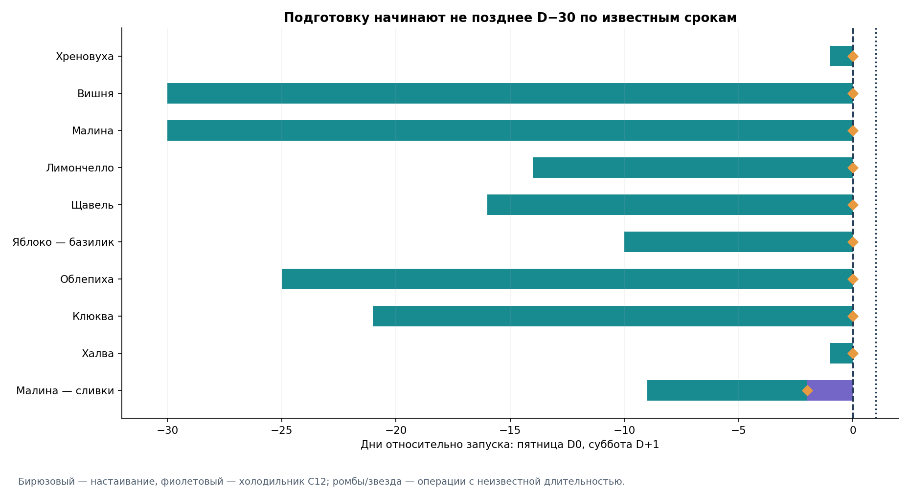
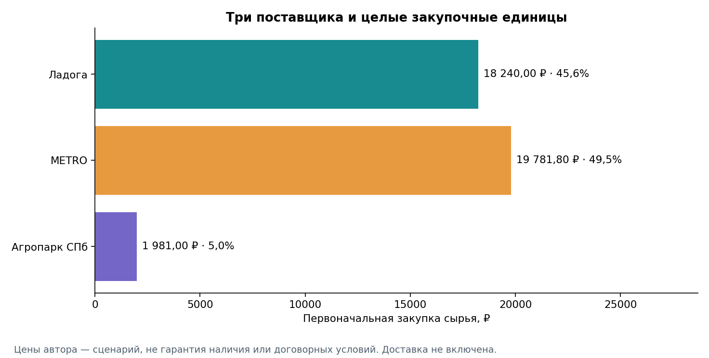
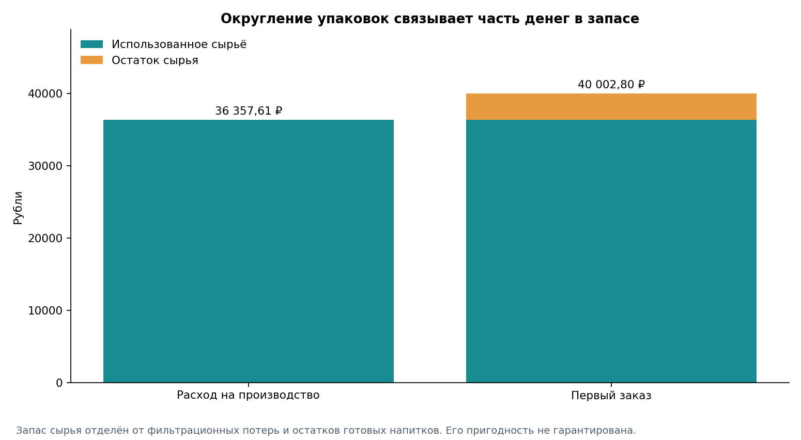
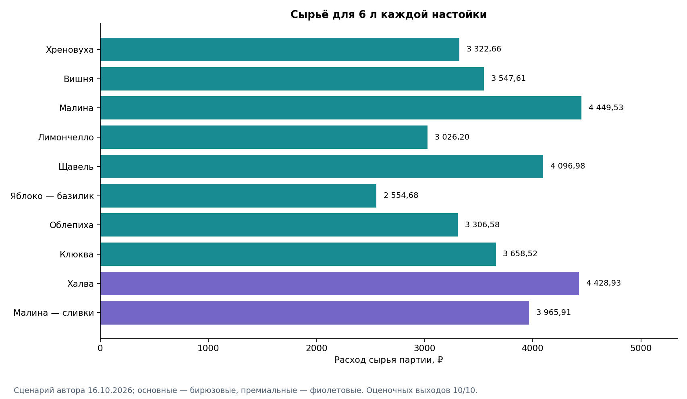
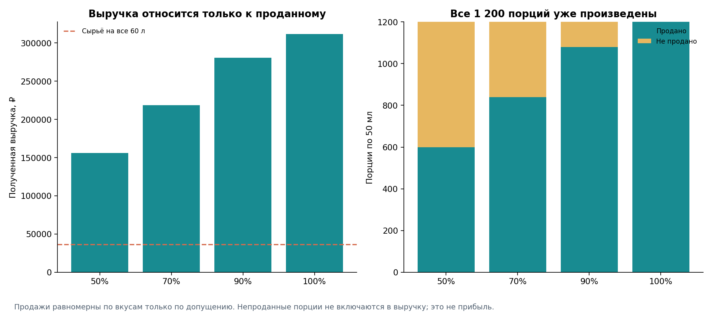

# Экономика запуска настоечного бара: авторский сценарий 60 литров

## Бизнес-задача

Бар Санкт-Петербурга готовит ассортимент для пятницы и субботы: по 60 порций каждого вкуса за вечер, порция 50 мл. Нужно оценить сырьё, стартовый платёж поставщикам и последствия неполных продаж. Это план, а не наблюдавшийся спрос.

Автор выбрал десять напитков, их составы, технологии и цены: восемь основных по 250 ₽ и две премиальные по 300 ₽. Оптимизатор не выбирает вкусы и не предлагает замены. [Ассортимент](../data/economics/author_selected_menu.csv) остался прежним; [задание автора](author_specification.md) является источником новых рецептур и цен. Предыдущие A/B/C/B2 и расчёт по 1 л сохранены [в истории](../data/economics/history/README.md), они не участвуют в действующей экономике.

## От исследования рынка к авторским рецептурам

Основа портфолио — прежнее исследование меню и публичных отзывов: 368 отзывов, 468 строк упоминаний, 198 подтверждённых конкретных упоминаний и 114 нормализованных вкусов. Люди, оставляющие отзывы, не представляют всех гостей; публикации не равны продажам. Первичная книга, старые CSV, методика сбора и ID сохранены побайтно. Клюква остаётся решением автора, а не результатом положительных дегустационных голосов.

В этой версии все десять составов имеют статус `author_supplied`. Ранее применявшиеся адаптации и модельные дозировки заменены. Факт предоставления рецепта автором не означает лабораторную проверку выхода, безопасности или срока хранения. Исходные выходы автора — `estimated`; в текущем наборе оценочных **10**, измеренных **0**. Их можно заменить в [yields.csv](../data/economics/yields.csv), указав `measured` и описание измерения, затем повторить расчёт без правки кода.

## Технологические и финансовые допущения

Основной план — **60 л**, 1 200 порций, строго по 6 л каждого вкуса. `scale_factor = 6000 / yield_ml`, количество сырья = дозировка исходной партии × коэффициент. Промежуточные количества и денежные суммы не округляются; используется Decimal с точностью 50 значащих цифр. Округляются реальные упаковки вверх и итоговое отображение.

Плановый готовый выход уже учитывает фильтрацию; второй процент потерь поверх него не накладывается. Готовый объём не равен объёму водки: в него переходят сок, растворённый сахар и другие компоненты, часть жидкости остаётся в сырье/фильтрах. Массу и миллилитры не складываем и не переводим через придуманную плотность. 40% относится к водке «Царская Оригинальная», а конечная крепость остаётся неизвестной.

Рецептурный источник один — [recipes.json](../data/economics/recipes.json), цены — [ingredients.csv](../data/economics/ingredients.csv), производственный план — [production_plan.json](../data/economics/production_plan.json). Дата ценового сценария — **16.10.2026**. Старые 726 ₽/0,5 л, вода в лимончелло, замороженное яблоко, прежняя молочная рецептура и выход халвы 722,5 мл в текущем расчёте не используются.

## Выбор поставщиков

Водка Ладоги стоит в сценарии автора 380 ₽/л, плановая единица 1 л. METRO поставляет все четыре замороженные ягоды, лимоны, щавель, базилик, сахар, мёд, халву, сливки и молоко. Агропарк СПб — только свежий корень хрена, имбирь и свежие зелёные яблоки. Лимоны и зелень не перенесены к другому поставщику.

Все цены сохранены как предоставленный автором сценарий. В поисковых представлениях каталога METRO найдены совпадающие объёмные ориентиры для вишни, малины, облепихи, клюквы и халвы, но прямое открытие карточек недоступно или требует JavaScript; они **не названы независимым подтверждением текущей цены магазина СПб**. Индекс указывает пороги от трёх упаковок ягод и от пятнадцати упаковок халвы. Основная корзина эти пороги проходит. Это не дополнительные скидки: в расчёте всё равно фиксированные цены автора. Доступность, акции, выбор торгового центра и способ получения нужно подтвердить.

Для хрена открытая карточка Агропарка противоречит названию: содержит воду, уксус и соль, неоднозначную фасовку. Это не подтверждение необработанного корня. В модели сохранены авторские 653 ₽/кг и плановый шаг 1 кг, но поставщику нужен заказ именно свежего корня, не соуса. Цена яблок 69 ₽/кг предоставлена автором; упаковка 1 кг для яблок/имбиря также является плановым шагом. URL, тип источника и статусы сохранены в справочнике. Тарифы доставки и минимальные суммы новых поставщиков неизвестны и не заменены нулями; бюджет ниже относится только к сырью.

## Производственный календарь

| ID | Вкус | Начало по известным срокам | Настаивание, дней | Холодильник, дней | Фильтрация / прочее |
| --- | --- | --- | --- | --- | --- |
| C01 | Хреновуха | D−1 | 1 | — | длительность не задана; до D0 |
| C02 | Вишня | D−30 | 30 | — | длительность не задана; до D0 |
| C03 | Малина | D−30 | 30 | — | длительность не задана; до D0 |
| C04 | Лимончелло | D−14 | 14 | — | длительность не задана; до D0 |
| C05 | Щавель | D−16 | 16 | — | длительность не задана; до D0 |
| C09 | Яблоко — базилик | D−10 | 10 | — | длительность не задана; до D0 |
| C13 | Облепиха | D−25 | 25 | — | длительность не задана; до D0 |
| C14 | Клюква | D−21 | 21 | — | длительность не задана; до D0 |
| C06 | Халва | D−1 | 1 | — | длительность не задана; до D0 |
| C12 | Малина — сливки | D−9 | 7 | 2 | длительность не задана; до D0 |

Пятница — D0, суббота — D+1. Конкретную дату запуска автор не задавал. Максимальный известный цикл — 30 дней; время подготовки, фильтрации, нагрева и розлива полностью не нормировано и может потребовать дополнительного времени. Маркеры фильтрации на диаграмме не означают нулевую длительность операции.

C12 требует 7 дней малиновой основы, фильтрации, приготовления и охлаждения молочной части, затем примерно 2 дней в холодильнике. Наблюдение автора `author_observed_storage_days = 14` сохранено, но **не является установленным безопасным сроком коммерческого хранения**. Нужны надлежащие условия холодильного хранения и проверка требований пищевой безопасности. Новые рецептурные эксперименты не проводились.

## Закупочная корзина

| Сырьё | Потребность | Покупаем | Единиц | Заказ, ₽ | Использовано, ₽ | Остаток | Остаток, ₽ |
| --- | --- | --- | --- | --- | --- | --- | --- |
| Водка Царская Оригинальная 40% | 47 300,705 ml | 48 000 ml | 48 | 18 240,00 | 17 974,27 | 699,295 ml | 265,73 |
| Вишня замороженная без косточек | 2 173,913 g | 3 000 g | 3 | 2 397,00 | 1 736,96 | 826,087 g | 660,04 |
| Малина замороженная | 5 218,487 g | 6 000 g | 6 | 5 994,00 | 5 213,27 | 781,513 g | 780,73 |
| Облепиха замороженная | 4 166,667 g | 5 000 g | 5 | 1 995,00 | 1 662,50 | 833,333 g | 332,50 |
| Клюква замороженная | 3 582,090 g | 4 000 g | 4 | 2 076,00 | 1 859,10 | 417,910 g | 216,90 |
| Лимоны целые | 7 600,000 g | 8 000 g | 8 | 1 432,00 | 1 360,40 | 400,000 g | 71,60 |
| Щавель свежий | 1 132,075 g | 1 200 g | 12 | 1 668,00 | 1 573,58 | 67,925 g | 94,42 |
| Базилик зелёный свежий | 138,462 g | 150 g | 3 | 447,00 | 412,62 | 11,538 g | 34,38 |
| Сахар | 9 710,840 g | 10 000 g | 10 | 729,00 | 707,92 | 289,160 g | 21,08 |
| Мёд | 2 459,735 g | 3 000 g | 3 | 987,00 | 809,25 | 540,265 g | 177,75 |
| Халва подсолнечная | 8 000,000 g | 8 000 g | 32 | 1 500,80 | 1 500,80 | 0,000 g | 0,00 |
| Сливки 10% | 1 285,714 ml | 2 000 ml | 2 | 398,00 | 255,86 | 714,286 ml | 142,14 |
| Молоко 3.2% | 1 285,714 ml | 2 000 ml | 2 | 158,00 | 101,57 | 714,286 ml | 56,43 |
| Хрен: свежий необработанный корень | 1 212,766 g | 2 000 g | 2 | 1 306,00 | 791,94 | 787,234 g | 514,06 |
| Имбирь свежий | 191,489 g | 1 000 g | 1 | 330,00 | 63,19 | 808,511 g | 266,81 |
| Яблоки зелёные свежие | 4 846,154 g | 5 000 g | 5 | 345,00 | 334,38 | 153,846 g | 10,62 |

Сначала суммируется расход всех десяти рецептур, затем `ceil(total_needed / pack_size)`. Число целых исходных рецептур не округляется. Водки требуется **47,300705 л**, покупаем 48 л. Малины для C03 и C12 вместе — **5,218487 кг**, покупаем 6 кг. При независимом округлении рецептов малины получилось бы 6 упаковок; разница первой кассы от совместного округления — **0,00 ₽**. В исходном сценарии и вместе, и раздельно нужны шесть упаковок: наличие общего ингредиента само по себе не создаёт экономии. Суммирование остаётся необходимым для корректной общей потребности и единого остатка. Использованная масса и её стоимость от этого не меняются.

Сырьё исходных партий и точная потребность — [recipe_ingredients.csv](../data/economics/results/recipe_ingredients.csv); матрица 10×16 — [ingredient_matrix.csv](../data/economics/results/ingredient_matrix.csv); фасовки и остатки — [procurement.csv](../data/economics/results/procurement.csv).

| Поставщик | Заказ, ₽ | Использовано, ₽ | Остаток, ₽ |
| --- | --- | --- | --- |
| Ладога | 18 240,00 | 17 974,27 | 265,73 |
| METRO | 19 781,80 | 17 193,83 | 2 587,97 |
| Агропарк СПб | 1 981,00 | 1 189,51 | 791,49 |

**Первоначальный платёж за сырьё — 40 002,80 ₽**. Стоимость использованного сырья — **36 357,61 ₽**, остаток по закупочной ставке — **3 645,19 ₽**. Остаток не является производственной потерей или автоматически списанным убытком. Свежие хрен, имбирь, яблоки, зелень, лимоны и открытая молочная продукция нуждаются в подходящем хранении; замороженные ягоды — в холодовой цепи. Годность повторного использования не предполагается без условий и фактической потребности.

В сырьевом запасе остаётся 9,11% первой кассы. Самые крупные остатки по стоимости: Малина замороженная — 780,73 ₽; Вишня замороженная без косточек — 660,04 ₽; Хрен: свежий необработанный корень — 514,06 ₽. Их повторное использование нельзя считать гарантированным покрытием следующих продаж; сначала нужны подходящий режим хранения и фактическая потребность.

Водка связывает 45,6% стартового бюджета. Это объясняет основной финансовый эффект замены прежней розничной котировки авторской, но не подтверждает условия поставки. Общая водка, сахар и мёд также объединяются перед округлением; универсальные ингредиенты не выдаются за доказательство вкусового разнообразия.

## Себестоимость напитков и цены

| ID | Настойка | Выход партии, мл* | Коэффициент | Сырьё 6 л, ₽ | 50 мл, ₽ | Цена, ₽ | Сырьевая маржинальность |
| --- | --- | --- | --- | --- | --- | --- | --- |
| C01 | Хреновуха | 470 | 12,765957 | 3 322,66 | 27,69 | 250 | 88,92% |
| C02 | Вишня | 690 | 8,695652 | 3 547,61 | 29,56 | 250 | 88,17% |
| C03 | Малина | 680 | 8,823529 | 4 449,53 | 37,08 | 250 | 85,17% |
| C04 | Лимончелло | 1 500 | 4,000000 | 3 026,20 | 25,22 | 250 | 89,91% |
| C05 | Щавель | 530 | 11,320755 | 4 096,98 | 34,14 | 250 | 86,34% |
| C09 | Яблоко — базилик | 650 | 9,230769 | 2 554,68 | 21,29 | 250 | 91,48% |
| C13 | Облепиха | 720 | 8,333333 | 3 306,58 | 27,55 | 250 | 88,98% |
| C14 | Клюква | 670 | 8,955224 | 3 658,52 | 30,49 | 250 | 87,80% |
| C06 | Халва | 450 | 13,333333 | 4 428,93 | 36,91 | 300 | 87,70% |
| C12 | Малина — сливки | 700 | 8,571429 | 3 965,91 | 33,05 | 300 | 88,98% |

\* Оценочных выходов 10, измеренных 0. Измерение выхода не подтверждает безопасность хранения. Подробные показатели включают стоимость исходной партии, сырьё 6 л, литра и 50 мл, доход на порцию и потенциальную выручку от 120 порций — [recipe_costs.csv](../data/economics/results/recipe_costs.csv).

При продаже всех порций потенциальная выручка — **312 000,00 ₽**. После стоимости израсходованного сырья остаётся **275 642,39 ₽**, сырьевая маржинальность — **88,35%**. Это не чистая прибыль: труд, аренда, налоги, эквайринг, оборудование, доставка, хранение и списания готового продукта не рассчитаны. Разница выручки и первоначальной закупки — 271 997,20 ₽ — отдельный денежный показатель, тоже не прибыль.

Небольшая сверка округления: сумма строк расходов на 6 л, уже показанных с двумя знаками, равна **36 357,60 ₽**. Сумма неокруглённых вычислений даёт **36 357,61 ₽**; разница отображения **0,01 ₽**. При исходных выходах автора это объясняет отличие связанных итогов от его контроля 36 357,60 ₽ на копейку. После изменения выхода контроль исходного сценария не применяется к новому результату. Расчётные агрегаты получены до округления, а не сложением видимых копеек; подгонки нет.

Премиальные цены 300 ₽ сохранены. Более высокая или низкая себестоимость не доказывает готовность гостя платить. Равный план выпуска не подтверждает равномерный спрос; отзывы не использовались как фактические веса продаж.

## Реализация и остаток готовой продукции

| Реализация | Продано / осталось, порций | Выручка, ₽ | Сырьё всех 60 л, ₽ | Выручка минус всё сырьё, ₽ | Готовый остаток по сырью, ₽ |
| --- | --- | --- | --- | --- | --- |
| 50% | 600 / 600 | 156 000,00 | 36 357,61 | 119 642,39 | 18 178,81 |
| 70% | 840 / 360 | 218 400,00 | 36 357,61 | 182 042,39 | 10 907,28 |
| 90% | 1 080 / 120 | 280 800,00 | 36 357,61 | 244 442,39 | 3 635,76 |
| 100% | 1 200 / 0 | 312 000,00 | 36 357,61 | 275 642,39 | 0,00 |

Во всех строках уже произведены все 60 л. Вариант 50% не уменьшает задним числом сырьевой расход на производство. Выручка включает только проданное; оставшиеся порции и их сырьевая стоимость показаны отдельно от остатка закупленных ингредиентов. В CSV дополнительно есть вклад после сырья только проданных порций и денежный остаток после всей закупки. Различия отражают разные вопросы, а не разные оценки чистой прибыли.

| Премиальные продажи | Средняя цена, ₽ | Среднее сырьё 50 мл, ₽ | Мат. маржинальность | Максимум продаж при этом mix* |
| --- | --- | --- | --- | --- |
| 5% | 252,50 | 29,42 | 88,35% | 1 010,53 |
| 20% | 260,00 | 30,30 | 88,35% | 1 200,00 |
| 35% | 267,50 | 31,18 | 88,35% | 685,71 |

\* Средний чек здесь относится только к порциям настоек. Внутри каждого уровня доли вкусов равны по допущению. Доступно 960 основных и 240 премиальных порций. При 35% премиальных продаж нельзя продать все 1 200 порций без изменения запаса. [premium_mix.csv](../data/economics/results/premium_mix.csv) проверяет сочетания с 50/70/90/100% реализации; невыполнимым сценариям не назначается выручка от отсутствующих порций. Дополнительные 7 л и новые вкусы не подставляются.

## Чувствительность к ценам, выходу и упаковкам

| Изменение цены сырья | Использовано, ₽ | Заказ, ₽ | Мат. маржинальность при полной реализации |
| --- | --- | --- | --- |
| -10% | 32 721,85 | 36 002,52 | 89,51% |
| 0% | 36 357,61 | 40 002,80 | 88,35% |
| 10% | 39 993,37 | 44 003,08 | 87,18% |
| 20% | 43 629,13 | 48 003,36 | 86,02% |

| Выход относительно плана | Использовано, ₽ | Заказ, ₽ | Цель готового объёма | Условия индексных цен* |
| --- | --- | --- | --- | --- |
| 80% | 45 447,02 | 48 464,70 | 60 000 мл | пороги пройдены |
| 90% | 40 397,35 | 42 699,30 | 60 000 мл | пороги пройдены |
| 100% | 36 357,61 | 40 002,80 | 60 000 мл | пороги пройдены |
| 110% | 33 052,37 | 35 801,10 | 60 000 мл | перепроверить cherry |

\* Цель всегда остаётся 60 л. Снижение выхода требует больше сырья для того же готового объёма. Это отдельный сценарий, не факт потерь. При изменении выхода пересчитываются коэффициенты и целые упаковки; индексные пороги оптовых цен могут перестать выполняться. Программа предупреждает об этом, сохраняя авторскую ставку сценария, а не придумывает другой тариф. Ввод измерения в yields.csv позволяет повторить весь расчёт без правки Python.

Изменение упаковок влияет на стартовую кассу и запас, а не на тариф используемого сырья. В procurement.csv для каждого ингредиента сохранены раздельное округление рецептов и совместное округление; новые скидки не добавлены. Чувствительность по каждому вкусу — [price_sensitivity.csv](../data/economics/results/price_sensitivity.csv) и [yield_sensitivity.csv](../data/economics/results/yield_sensitivity.csv).

## Авторские технологии исходных партий

Количество ниже относится к одной исходной партии, а не к 6 л. Источник всех составов и операций — автор проекта. Поля источника и наблюдаемого хранения сохранены отдельно от подтверждённых измерений.

### C01 — Хреновуха

Водка Царская Оригинальная 40% — 500 ml; Хрен: свежий необработанный корень — 95 g; Имбирь свежий — 15 g; Мёд — 10 g.

1. Авторский технологический ориентир: настаивание 1 дн. 2. Получить процеженный напиток; длительность и отдельные операции фильтрации автором не нормированы. Хрен 90–100 г; для экономики выбрана середина 95 г.

Плановый выход исходной партии: **470 мл**, статус `estimated`. Состав — `author_supplied`.

### C02 — Вишня

Водка Царская Оригинальная 40% — 500 ml; Вишня замороженная без косточек — 250 g; Сахар — 250 g.

1. Авторский технологический ориентир: настаивание 30 дн. 2. Получить процеженный напиток; длительность и отдельные операции фильтрации автором не нормированы.

Плановый выход исходной партии: **690 мл**, статус `estimated`. Состав — `author_supplied`.

### C03 — Малина

Водка Царская Оригинальная 40% — 500 ml; Малина замороженная — 300 g; Сахар — 200 g.

1. Авторский технологический ориентир: настаивание 30 дн. 2. Получить процеженный напиток; длительность и отдельные операции фильтрации автором не нормированы.

Плановый выход исходной партии: **680 мл**, статус `estimated`. Состав — `author_supplied`.

### C04 — Лимончелло

Водка Царская Оригинальная 40% — 1 000 ml; Лимоны целые — 1 900 g; Сахар — 500 g.

1. Снять всю жёлтую цедру без белой части. 2. Выжать весь сок из целых лимонов. 3. С самого начала соединить водку 40%, цедру, весь сок и сахар. Воду не добавлять. 4. Настаивать 14 дней, затем процедить.

Плановый выход исходной партии: **1 500 мл**, статус `estimated`. Состав — `author_supplied`.

### C05 — Щавель

Водка Царская Оригинальная 40% — 500 ml; Щавель свежий — 100 g; Мёд — 100 g.

1. Авторский технологический ориентир: настаивание 16 дн. 2. Получить процеженный напиток; длительность и отдельные операции фильтрации автором не нормированы.

Плановый выход исходной партии: **530 мл**, статус `estimated`. Состав — `author_supplied`.

### C09 — Яблоко — базилик

Водка Царская Оригинальная 40% — 500 ml; Яблоки зелёные свежие — 525 g; Базилик зелёный свежий — 15 g; Сахар — 80 g.

1. Авторский технологический ориентир: настаивание 10 дн. 2. Получить процеженный напиток; длительность и отдельные операции фильтрации автором не нормированы.

Плановый выход исходной партии: **650 мл**, статус `estimated`. Состав — `author_supplied`.

### C13 — Облепиха

Водка Царская Оригинальная 40% — 500 ml; Облепиха замороженная — 500 g; Сахар — 100 g.

1. Авторский технологический ориентир: настаивание 25 дн. 2. Получить процеженный напиток; длительность и отдельные операции фильтрации автором не нормированы.

Плановый выход исходной партии: **720 мл**, статус `estimated`. Состав — `author_supplied`.

### C14 — Клюква

Водка Царская Оригинальная 40% — 500 ml; Клюква замороженная — 400 g; Сахар — 150 g.

1. Авторский технологический ориентир: настаивание 21 дн. 2. Получить процеженный напиток; длительность и отдельные операции фильтрации автором не нормированы.

Плановый выход исходной партии: **670 мл**, статус `estimated`. Состав — `author_supplied`.

### C06 — Халва

Водка Царская Оригинальная 40% — 500 ml; Халва подсолнечная — 600 g; Мёд — 90 g.

1. Авторский технологический ориентир: настаивание 1 дн. 2. Получить процеженный напиток; длительность и отдельные операции фильтрации автором не нормированы.

Плановый выход исходной партии: **450 мл**, статус `estimated`. Состав — `author_supplied`.

### C12 — Малина — сливки

Водка Царская Оригинальная 40% — 300 ml; Малина замороженная — 300 g; Сливки 10% — 150 ml; Молоко 3.2% — 150 ml; Сахар — 100 g.

1. Соединить малину и водку в стеклянной банке, закрыть и оставить на 7 дней в темноте при комнатной температуре, затем процедить. 2. Сливки 10%, молоко 3.2% и сахар нагревать при помешивании до растворения сахара, не доводя до кипения. 3. Остудить сливочную основу и смешать с процеженной малиновой основой. 4. Поместить в холодильник приблизительно на 2 дня. Перед подачей взболтать при расслоении. Наблюдение автора о 14 днях хранения сохранено отдельно; безопасный коммерческий срок не установлен.

Плановый выход исходной партии: **700 мл**, статус `estimated`. Состав — `author_supplied`.

Для C04 1 900 г — масса закупаемых целых лимонов, не цедры: используются вся жёлтая цедра и весь сок, сахар вводится с самого начала, вода отсутствует. C09 использует только свежие зелёные яблоки 525 г, не прежние замороженные 350 г. У C06 консервативный выход 450 мл; старые 722,5 мл не применяются. C02 — 250 г вишни без косточек, C03 — 200 г сахара. C12 имеет две отдельные основы и молоко, которых не было в прежнем расчёте.

## Что требуется для запуска и пределы выводов

Нужно подтвердить поставку водки по авторской цене, магазин/акции METRO, подходящий необработанный хрен, фактические весовые единицы Агропарка и условия трёх поставщиков, включая доставку. Перед производством важны наличие холодильных ёмкостей, рабочие операции и время фильтрации/розлива. После производства следует внести измеренные выходы; наблюдение о хранении молочной настойки не заменяет проверки требований безопасности и условий хранения.

Заданная потребность в 120 порций каждого вкуса — план автора, а не подтверждённый спрос. Сырьевая маржинальность высокая в данном ценовом сценарии, но не отвечает на вопрос о полной прибыльности бара. Упаковочные остатки и непроданные готовые напитки требуют разного управления. На этом этапе ассортимент и технология не менялись, эксперименты с новыми рецептами не проводились.

## Воспроизведение и контроль качества

`python scripts/economics.py` заново формирует таблицы, шесть графиков, README и этот отчёт. Notebook вызывает тот же расчёт, не содержит собственного набора рецептур или цен. Manifest сохраняет SHA256 входов и выходных таблиц. [Протокол свежих проверок](validation.md) отдельно фиксирует входы, новый запуск тестов и выполнение Notebook; прошлые статусы не считаются новым прогоном. SHA256 первичной базы проверяются при каждом запуске, исторический архив имеет собственный manifest.
